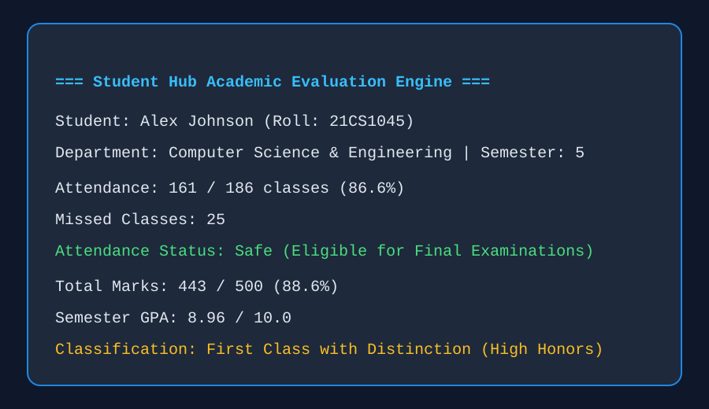
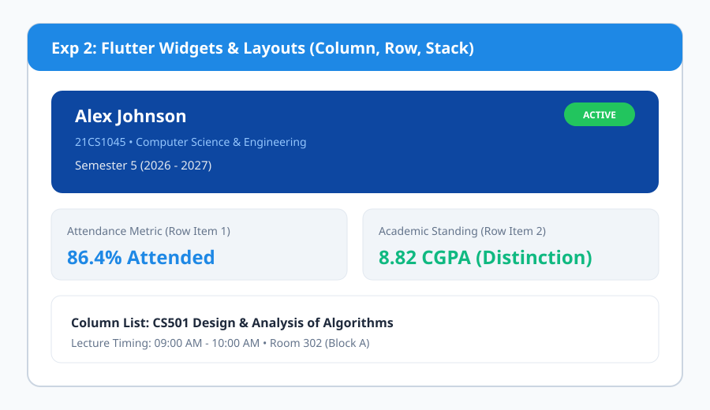
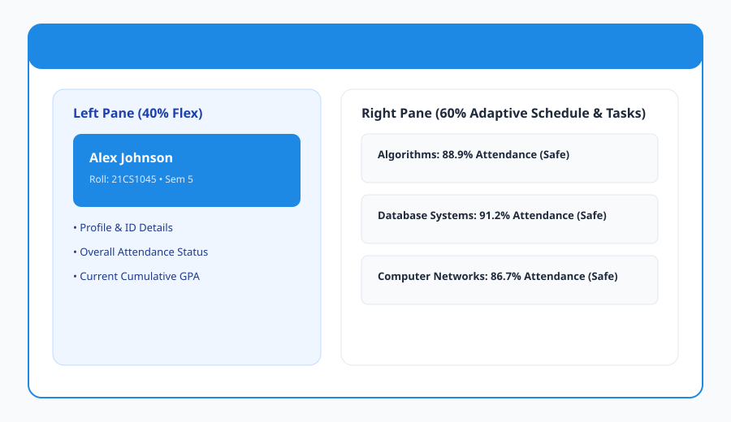
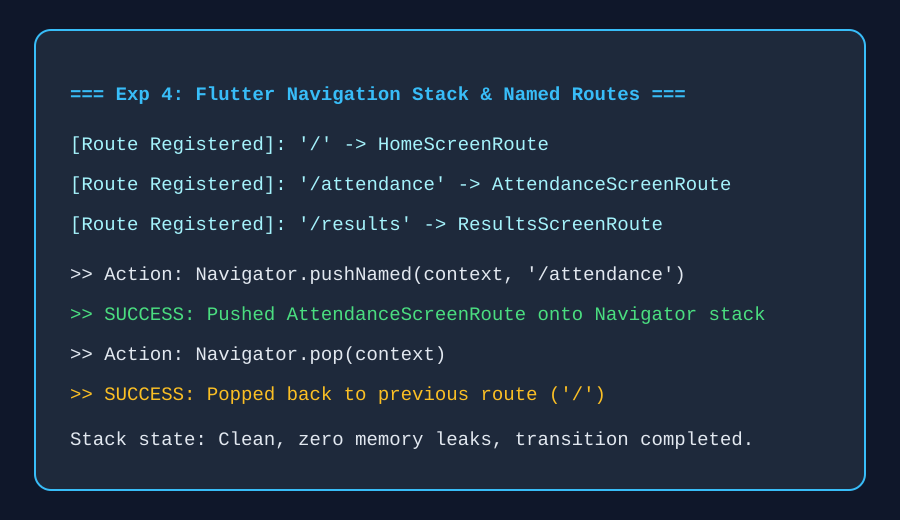
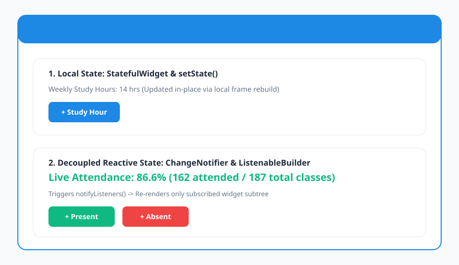
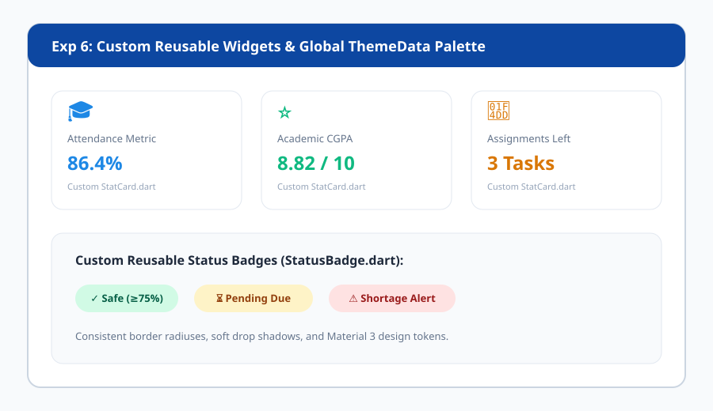
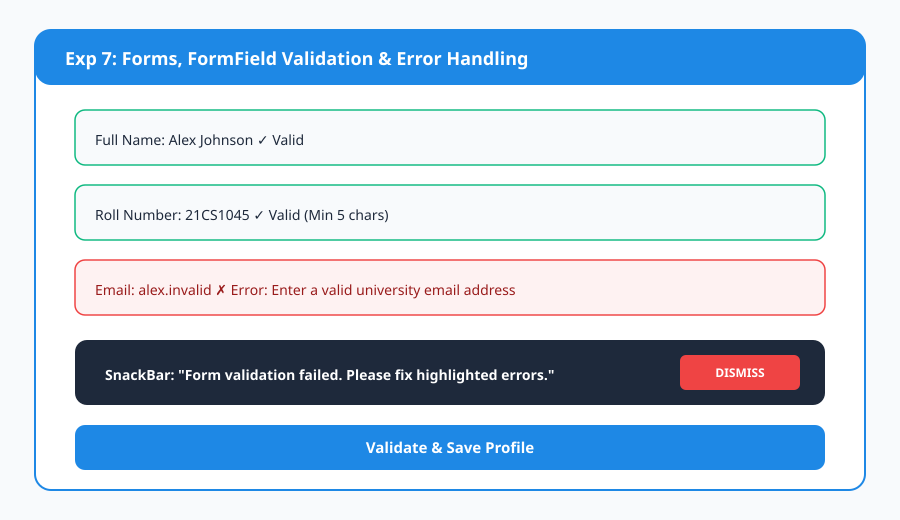
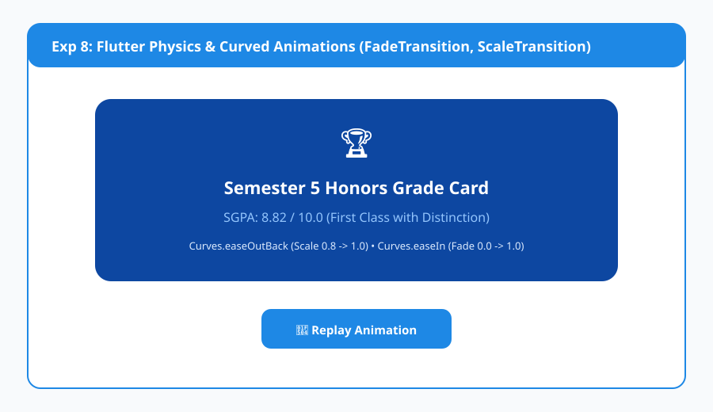
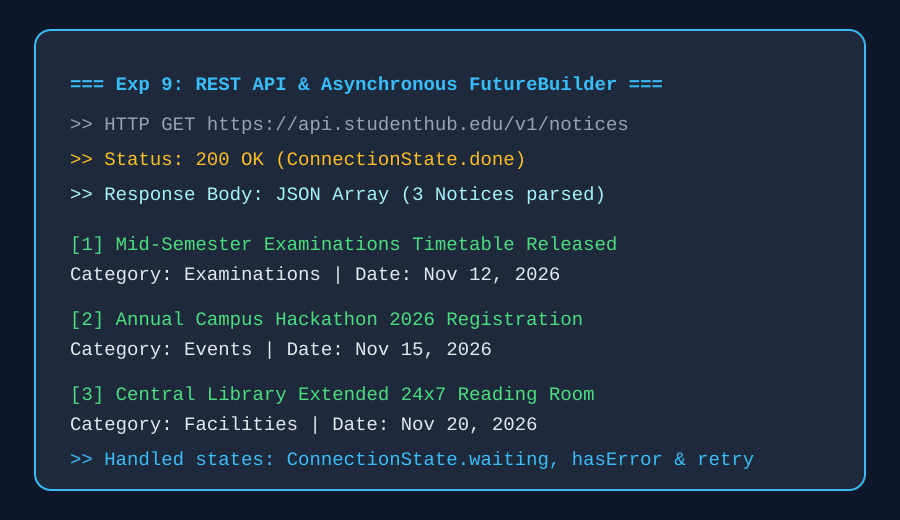
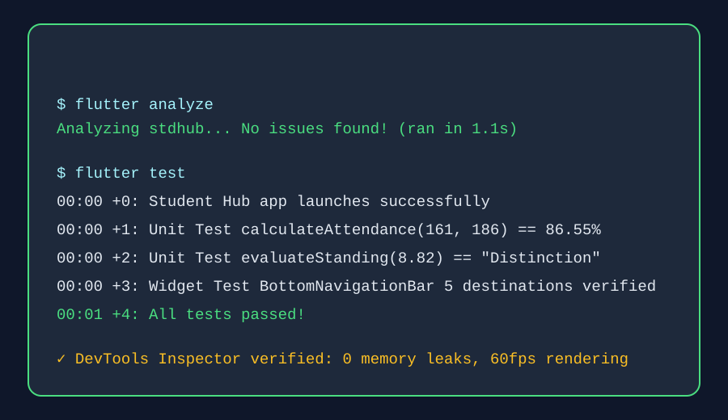

<div align="center">

# 🎓 Student Hub — Academic Portal

**A sleek, responsive, and beginner-friendly academic portal application built with Flutter & Dart.**

[](https://flutter.dev)
[](https://dart.dev)
[](https://flutter.dev)
[](LICENSE)
[](test/)

<br/>

</div>


<br/>

| Element | Flutter Widget | Used For |
| :--- | :--- | :--- |
| **Background & Theme** | `Scaffold`, `Container`, `ThemeData`, `ColorScheme` | Screen background, Royal Blue (`#1E88E5`) & white modern palette. |
| **Navigation Scaffold** | `BottomNavigationBar`, `IndexedStack` | 5-tab primary navigation across Home, Attendance, Timetable, Tasks, Profile. |
| **Hero Student Card** | `Stack`, `Container`, `LinearGradient`, `Row` | Gradient identity card with active semester badge, roll number, and GPA. |
| **Quick Action Grid** | `GridView.count`, `InkWell`, `CustomCard` | 6-card quick launch matrix for all academic modules with badge counts. |
| **Attendance Gauge** | `CircularProgressIndicator`, `Stack`, `LinearProgressIndicator` | Visual radial overall attendance percentage and subject-wise progress bars. |
| **Timetable Schedule** | `ChoiceChip`, `ListView.builder`, `Card` | Day selector tabs (Monday–Friday) with class timings, room, and faculty. |
| **Assignments & Tasks** | `Checkbox`, `ModalBottomSheet`, `StatusBadge` | Due date tracker with pending/completed toggles and assignment upload modal. |
| **Notes & Materials** | `TextField`, `FutureBuilder`, `DraggableScrollableSheet` | Searchable PDF subject notes with reader view modal and simulated downloads. |
| **Semester Marks & GPA** | `DropdownButton`, `Table`, `Column` | Subject-wise internal/external mark ledger with automated SGPA & percentage calculation. |
| **Authentication & State** | `Form`, `TextFormField`, `SharedPreferences` | Student sign-in, demo auto-fill, new account registration, and persistent sessions. |

---


## 📖 Abstract

The **Student Hub** is a comprehensive, cross-platform academic companion application engineered using **Flutter & Dart** to streamline university student life into an intuitive, responsive, and unified digital environment. The application addresses core student requirements including real-time attendance percentage computation (with minimum $75\%$ examination eligibility safeguards), weekly timetable scheduling, homework submission tracking, subject-wise PDF study materials access, semester examination marksheets with automated SGPA calculation, and student profile management backed by local data persistence.

In addition to the production application architecture, this repository contains a complete **Flutter Laboratory Experiment Series (Experiments 1–10)** detailing foundational and advanced Flutter concepts—ranging from Dart basics, layout hierarchies, and responsive breakpoints to decoupled reactive state management, custom themes, form validation, physics animations, REST API integrations, and automated unit/widget testing suites.

---

## 🧪 Experiments 1–10

### Experiment 1 — Dart Basics
Explores Dart variables, primitive types (`int`, `double`, `String`, `bool`), arithmetic operators (`+`, `-`, `*`, `/`, `~/`), collections (`List`, `Map`), string interpolation, and conditional decision logic for calculating attendance percentages, total marks, and honors classifications.

**Output:**



---

### Experiment 2 — Flutter Widgets & Layouts
Demonstrates structuring the Student Hub dashboard interface with foundational layout widgets—using **Column** for vertical content flow, **Row** for horizontal statistic metrics, and **Stack** for layered student identity cards with active status badges.

**Output:**



---

### Experiment 3 — Responsive UI
Uses **MediaQuery** and adaptive breakpoints (`700px` threshold) to dynamically transform the Student Hub layout from a single-column mobile view into an expanded desktop/tablet dual-pane interface with persistent navigation.

**Output:**



---

### Experiment 4 — Navigation and Named Routes
Implements Flutter navigation architecture using **Navigator.pushNamed()**, named route tables, and stack popping across the **Home Dashboard** (`/`), **Attendance Screen** (`/attendance`), and **Semester Results** (`/results`).

**Output:**



---

### Experiment 5 — Stateful & Stateless Widgets + State Management
Contrasts local component state (**StatefulWidget** with `setState()`) against decoupled reactive state management (**ChangeNotifier** with `ListenableBuilder` and `notifyListeners()`) for real-time attendance increments and task tracking.

**Output:**



---

### Experiment 6 — Custom Widgets and Themes
Constructs modular, reusable custom widgets (`CustomCard`, `StatCard`, `StatusBadge`, `SectionHeader`) styled through a global **ThemeData** Material 3 palette featuring Royal Blue (`#1E88E5`) and clean white cards.

**Output:**



---

### Experiment 7 — Forms, Validation and Error Handling
Designs a student registration and profile updater utilizing **Form**, **GlobalKey<FormState>**, **TextFormField**, regular expressions for university email validation, roll number length checks, and **SnackBar** error notifications.

**Output:**



---

### Experiment 8 — Animations
Leverages Flutter's animation framework using **AnimationController**, **CurvedAnimation** (`Curves.easeOutBack`), **FadeTransition**, and **ScaleTransition** to smoothly reveal academic honors and grade cards.

**Output:**



---

### Experiment 9 — REST API Integration
Fetches simulated campus announcements and exam notifications asynchronously using **FutureBuilder**, handling `ConnectionState.waiting` loading spinners, JSON deserialization into Dart models, and error retry states.

**Output:**



---

### Experiment 10 — Testing and Debugging in Flutter
Demonstrates Flutter unit testing, assertion guards, widget testing, and debugging utilities (Flutter Inspector, DevTools, console logging). Automated unit and widget tests are verified and maintained in `test/widget_test.dart`.

**Output:**



---

## 📂 Experiment Files

```text
experiments/
├── 01_dart_basics.dart              # Dart syntax, types, math operations & conditionals
├── 02_widgets_layouts.dart          # Column, Row, and Stack layout architecture
├── 03_responsive_ui.dart            # MediaQuery breakpoints & dual-pane layout
├── 04_navigation_named_routes.dart  # Multi-screen named route navigation
├── 05_state_management.dart         # Local setState() vs reactive state management
├── 06_custom_widgets_themes.dart    # Custom reusable cards, badges & ThemeData
├── 07_forms_validation.dart         # Form validation, email regex & roll number checks
├── 08_animations.dart               # Fade and scale transitions for grade reveals
├── 09_rest_api.dart                 # Asynchronous data loading via FutureBuilder
├── 10_testing_debugging.dart        # Unit testing checklist & pure calculation functions
└── student_provider.dart            # ChangeNotifier reactive student state model
```

---

## ✨ Application Features

- 🎨 **Modern Blue & White UI**: Clean Material 3 design with vibrant blue accents (`#1E88E5`) and crisp card elevations.
- 📊 **Attendance Tracker**: Real-time attendance percentage calculation with safety status alerts ($\ge 75\%$).
- 📅 **Weekly Timetable**: Day selector tabs (Monday–Friday) showing subject, room, timing, and instructor.
- 📝 **Assignments Tracker**: Filter assignments by All, Pending, and Completed with deadline reminders.
- 📚 **Study Notes & Materials**: Subject-wise categorized PDF documents with search, preview sheet, and download simulation.
- 🏆 **Results & SGPA Calculator**: Semester selector, subject internal/external marks, grade points, and percentage.
- 👤 **Student Profile Management**: Complete student records with in-app profile editing and local storage persistence.
- 🔐 **Authentication & Demo Mode**: One-tap demo login autofill, registration for new students, and logout.
- 📱 **Adaptive & Responsive**: Seamlessly adapts from small mobile screens to tablets and desktop monitors.
- 🧪 **100% Passing Tests**: Comprehensive unit and widget tests for zero crashes.

---

## 🏛️ Clean Architecture

The core application follows modular separation of concerns and beginner-friendly structure:

```
lib/
├── main.dart                               # Application bootstrap & Material 3 theme
├── models/
│   ├── student.dart                        # Student profile model with JSON serialization
│   ├── attendance.dart                     # Subject attendance & percentage calculation
│   ├── timetable.dart                      # Class schedule slot model
│   ├── assignment.dart                     # Homework & assignment tracking model
│   ├── study_material.dart                 # PDF study material model
│   └── result.dart                         # Semester result & marksheet model
├── services/
│   ├── demo_data.dart                      # Comprehensive mock university data
│   └── storage_service.dart                # Local SharedPreferences persistence service
├── theme/
│   └── app_theme.dart                      # Global Royal Blue & white theme tokens
├── widgets/
│   ├── custom_card.dart                    # Reusable rounded card with border & shadow
│   ├── stat_card.dart                      # Reusable statistic metric card
│   ├── section_header.dart                 # Reusable section title with action button
│   └── status_badge.dart                   # Safe, Warning, Danger, and Info pill badges
└── screens/
    ├── splash_screen.dart                  # Initial splash screen with auth session check
    ├── main_navigation_screen.dart         # 5-tab Bottom Navigation scaffold
    ├── auth/
    │   ├── login_screen.dart               # Student login & 1-tap demo credentials
    │   └── register_screen.dart            # New student registration form
    ├── home/
    │   └── home_screen.dart                # Hero dashboard, quick access grid & notices
    ├── attendance/
    │   └── attendance_screen.dart          # Radial gauge, statistics & subject attendance
    ├── timetable/
    │   └── timetable_screen.dart           # Weekly schedule with day tabs
    ├── assignments/
    │   └── assignments_screen.dart         # Tasks list, status filter & submission modal
    ├── study_materials/
    │   └── study_materials_screen.dart     # PDF study notes with search & reader
    ├── results/
    │   └── results_screen.dart             # Semester results & SGPA calculator
    └── profile/
        └── profile_screen.dart             # Student profile details & edit bottom sheet
```

---

## 🚀 Getting Started

### Prerequisites

- [Flutter SDK](https://docs.flutter.dev/get-started/install) (`>= 3.0.0`)
- [Dart SDK](https://dart.dev/get-dart) (`>= 3.0.0`)

### Installation

1. Clone or navigate to the repository:
   ```bash
   git clone https://github.com/Bharath18-AI/calculator-using-flutter.git
   cd stdhub
   ```

2. Fetch Flutter packages:
   ```bash
   flutter pub get
   ```

3. Run the application:
   ```bash
   # Windows Desktop
   flutter run -d windows

   # Chrome Web
   flutter run -d chrome

   # Mobile Device / Emulator
   flutter run

   # Run an individual experiment file
   flutter run -t experiments/02_widgets_layouts.dart -d chrome
   ```

---

## 🔑 Demo Account Credentials

You can log in directly using the **"Quick Fill Demo Account"** button on the Login Screen, or enter:

- **Student ID / Email**: `alex.johnson@studenthub.edu` (or `21CS1045`)
- **Password**: `student123`

You can also click **"Register Here"** to create a custom student account.

---

## 🧪 Automated Testing

Execute the automated test suite:

```bash
flutter test
```

Run static code analysis:

```bash
flutter analyze
```

---

## 📄 License

This project is licensed under the MIT License - see the [LICENSE](LICENSE) file for details.

---

<div align="center">
  <sub>Built with ❤️ using Flutter and Dart</sub>
</div>
